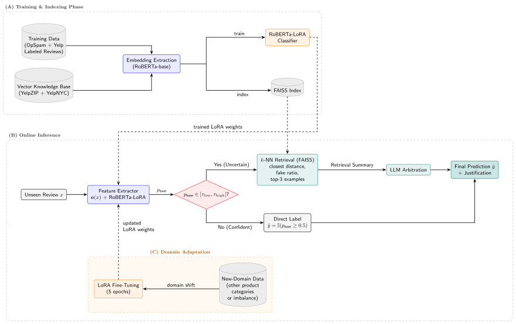

# Hybrid RAG for Deceptive Review Detection

The system combines three layers:

1. **A supervised classifier** — `roberta-base` fine-tuned with a rank-8 LoRA
   adapter and class-weighted cross-entropy.
2. **A semantic memory** — 768,683 labelled YelpNYC and YelpZIP reviews encoded
   with `roberta-base`, stored as 768-dimensional vectors and searched with
   FAISS.
3. **An LLM reasoning layer** — invoked only when the classifier probability
   falls inside the uncertainty window $[\tau_{low}, \tau_{high}]$, where it receives the
   classifier score, retrieval statistics and the three most similar labelled
   reviews before producing a final label and a grounded explanation.

The central design choice is selective reasoning: confident reviews bypass the LLM entirely, which keeps latency and cost low while adding evidence-backed explanations precisely where the classifier is least reliable.

---

## Table of contents

- [Hybrid RAG for Deceptive Review Detection](#hybrid-rag-for-deceptive-review-detection)
  - [Table of contents](#table-of-contents)
  - [Architecture](#architecture)
  - [Exdpermient Results](#exdpermient-results)
  - [Repository layout](#repository-layout)
  - [Installation](#installation)
    - [LLM backend](#llm-backend)
  - [Data and model artefacts](#data-and-model-artefacts)
  - [Quick start](#quick-start)
  - [Notebooks](#notebooks)
    - [Core pipeline](#core-pipeline)
    - [Experiments and analysis](#experiments-and-analysis)
  - [Configuration](#configuration)
  - [Tests](#tests)

---

## Architecture

<p align="center">
  
</p>

The classifier produces  `p_clf = P(fake | review)`. If interpolation is enabled, the base score is `p_base = 0.55 · p_clf + 0.45 · p_knn`, where `p_knn`
is the fraction of fake reviews among the top-20 neighbours. A review outside $[\tau_{low}, \tau_{high}]$ is labelled directly and never reaches the LLM. Inside the
window, the pipeline retrieves the closest labelled reviews, passes their fake
ratio and the top-3 examples to the LLM, and keeps the raw response for audit.

---

## Exdpermient Results

Classifier comparison on the in-domain test split:

| Model | Accuracy | F1 | Precision | Recall | PR-AUC |
|---|---:|---:|---:|---:|---:|
| TF-IDF + LogReg | 0.7614 | 0.5766 | 0.6154 | 0.5424 | 0.4708 |
| RoBERTa + LogReg | 0.6904 | 0.5674 | 0.4878 | 0.6780 | 0.4272 |
| RoBERTa + SVM | 0.7157 | 0.5484 | 0.5231 | 0.5763 | 0.4283 |
| **RoBERTa-LoRA** | **0.8115** | **0.6837** | **0.6846** | **0.6829** | **0.6918** |

Full pipeline across the three evaluation scenarios:

| Scenario | Setup | Acc | Prec | Rec | F1-Macro |
|---|---|---:|---:|---:|---:|
| In-domain | RoBERTa-LoRA | 0.8130 | 0.6862 | 0.6880 | 0.7769 |
| In-domain | **Full RAG** | **0.8237** | **0.7424** | 0.6266 | **0.7790** |
| Hotel Reviews, zero-shot | RoBERTa-LoRA | 0.6712 | 0.1684 | 0.6007 | 0.5257 |
| Hotel Reviews, zero-shot | **Full RAG** | **0.7656** | **0.1967** | 0.4539 | **0.5674** |
| Hotel Reviews, 5-epoch | RoBERTa-LoRA | 0.7083 | 0.2132 | 0.6136 | 0.5655 |
| Hotel Reviews, 5-epoch | **Full RAG** | **0.8592** | **0.3520** | 0.3333 | **0.6318** |
| Cross-domain, zero-shot | RoBERTa-LoRA | 0.5790 | 0.5613 | 0.6819 | 0.5751 |
| Cross-domain, zero-shot | **Full RAG** | **0.6300** | **0.6391** | 0.5788 | **0.6288** |
| Cross-domain, 5-epoch | RoBERTa-LoRA | 0.8217 | 0.7579 | 0.9196 | 0.8211 |
| Cross-domain, 5-epoch | **Full RAG** | **0.8433** | **0.8067** | 0.8829 | **0.8433** |

Metrics treat **fake = positive class (1)**; F1-Macro is the unweighted mean of
the two per-class F1 scores.

The RAG layer consistently trades recall for precision. Paired bootstrap tests
(N = 2,000) show significant precision gains of **+0.0562** in-domain,
**+0.1388** on adapted Hotel Reviews and **+0.0416** on adapted Cross-Domain, while F1 changes are not statistically significant. See [`results/tables/bootstrap_significance.csv`](results/tables/bootstrap_significance.csv) for the confidence intervals.

Grounding is also measured. The classic prompt reaches
100.0% / 99.5% / 80.5% Evidence Grounding Rate on in-domain, adapted Hotel and adapted Cross-Domain respectively, versus 0.5% / 0.5% / 0.0% for the light prompt. Positive Correction Rates are 25.1% / 31.3% / 25.0% for classic and 25.6% / 23.1% / 19.3% for light. The curated tables are in [`results/tables/`](results/tables/), including [`interpretability_metrics.csv`](results/tables/interpretability_metrics.csv) and [`llm_model_comparison.csv`](results/tables/llm_model_comparison.csv).

---

## Repository layout

```text
.
├── README.md                     ← this file
├── requirements.txt
│
├── src/spam_detection/           ← reusable library (see module docstrings)
│   ├── config.py                 ← paths, dataset sources, defaults
│   ├── preprocessing.py          ← cleaning, 80/20 split, knowledge-base frame
│   ├── embeddings.py             ← roberta-base / sentence-transformer encoders
│   ├── classifier.py             ← LoRA loading, training and inference
│   ├── retrieval.py              ← FAISS build, search and evidence summaries
│   ├── prompts.py                ← classic and light LangChain prompts
│   ├── pipeline.py               ← routing, interpolation and ablation runs
│   ├── evaluation.py             ← metrics and result tables
│   ├── statistics.py             ← McNemar, bootstrap, PCR, bin analysis
│   └── utils.py                  ← label parsing, seeding, helpers
│
├── notebooks/
│   ├── 01_dataset_download.ipynb
│   ├── 02_preprocess_classifier_data.ipynb
│   ├── 03_build_vector_database.ipynb
│   ├── 04_baselines_tfidf.ipynb
│   ├── 05_baselines_roberta_embeddings.ipynb
│   ├── 06_finetune_roberta_lora.ipynb
│   ├── 07_dataset_eda.ipynb
│   └── experiments/
│       ├── 08_ablation_in_domain.ipynb
│       ├── 09_ablation_hotel_reviews.ipynb
│       ├── 10_ablation_cross_domain.ipynb
│       ├── 11_domain_adaptation.ipynb
│       └── 12_statistical_analysis.ipynb
│       
│
├── scripts/predict.py            ← optional CLI wrapper
├── results/tables/               ← tables and archived CSVs
├── tests/                        ← stdlib unittest suite
│
├── data/                         ← datasets and FAISS artefacts (ignored)
└── models/roberta_lora_adapter/  ← released rank-8 adapter (committed)

```

---

## Installation

Python **3.10–3.12** is recommended; PyTorch and FAISS wheels may lag behind the newest Python releases.

```bash
python -m venv .venv
source .venv/bin/activate        # Windows: .venv\Scripts\activate
pip install -r requirements.txt
```

GPU execution is strongly recommended for notebook 03 (embedding 768k reviews) and notebook 06 (LoRA fine-tuning).

### LLM backend

The reasoning layer uses **Ollama** through `langchain-ollama`:

```bash
ollama serve
ollama pull llama3.1:8b-instruct-q8_0
```

Any Ollama-compatible chat model can be used by overriding
`SPAM_LLM_MODEL` or by passing `model_name=` to `create_hybrid_chain`. The study uses Llama-3.1-8B-Instruct for the main pipeline.

---

## Data and model artefacts

Raw datasets, the FAISS index and retrained adapters are not committed because they total several gigabytes. The repository ships only the released rank-8 LoRA adapter under `models/roberta_lora_adapter/` (about 3.5 MB).

| Dataset | Role | Rows | Labels | Source |
|---|---|---:|---|---|
| Deceptive Opinion Spam Corpus v1.4 (OpSpam) | Classifier training, hotel | 1,600 | `0` genuine / `1` fake | <https://myleott.com/op_spam_v1.4.zip> |
| Yelp Fake Review Dataset (Kaggle) | Classifier training, restaurant | 5,000 | `N` genuine / `Y` fake | <https://www.kaggle.com/datasets/virenraina/yelp-fake-review-dataset> |
| YelpNYC + YelpZIP | FAISS knowledge base only | 768,683 | fake / genuine (≈86/14) | [ScienceDB DOI 10.57760/sciencedb.17086](https://doi.org/10.57760/sciencedb.17086) |
| Hotel Reviews sample (Kaggle) | Imbalanced external evaluation (≈90/10) | 3,000 | `1` genuine / `-1` fake | <https://www.kaggle.com/datasets/abidmeeraj/yelp-labelled-dataset> |
| Cross-domain reviews (Kaggle) | Balanced external evaluation (50/50) | 3,000 | `CG` fake / `OR` real | <https://www.kaggle.com/datasets/mexwell/fake-reviews-dataset> |


The released adapter uses `roberta-base`, LoRA rank `r=8`, `lora_alpha=16`,
dropout `0.1`, target modules `query`/`value`, and `SEQ_CLS` with two labels.
It was trained for 10 epochs at learning rate `1e-4`, batch size 16, maximum
length 256, warm-up ratio 0.06, with validation precision as the selection metric. Notebook `06` retrains from scratch into
`models/roberta_lora_adapter_retrained/`, so the shipped artefact is never overwritten.

---

## Quick start

The following example scores one review end-to-end with the classic RAG prompt.
It assumes the FAISS index has already been built and Ollama is running.

```python
import pandas as pd

from spam_detection.classifier import load_roberta_model, predict_roberta_proba
from spam_detection.config import VECTOR_DB_INDEX, VECTOR_DB_PARQUET
from spam_detection.embeddings import encode_texts
from spam_detection.pipeline import run_hybrid_pipeline
from spam_detection.prompts import create_hybrid_chain
from spam_detection.retrieval import load_labeled_faiss_db, precompute_faiss_summaries

reviews = pd.DataFrame(
    {
        "text": [
            "Amazing place! Best hotel ever! 10/10 would definitely recommend!!!",
            "Stayed three nights. The room was small but clean, and the staff "
            "helped us find a late-night pharmacy after our flight was delayed.",
        ],
        "label": [1, 0],  # optional; only used for evaluation
    }
)

model, tokenizer = load_roberta_model()
probas = predict_roberta_proba(reviews["text"].tolist(), model, tokenizer)

embeddings = encode_texts(reviews["text"].tolist(), normalize=True)
faiss_db = load_labeled_faiss_db(VECTOR_DB_PARQUET, VECTOR_DB_INDEX)
summaries = precompute_faiss_summaries(
    embeddings, faiss_db, k_neighbors=20, show_progress=False
)

results = run_hybrid_pipeline(
    df=reviews,
    clf_probas=probas,
    true_labels=reviews["label"],
    llm_chain=create_hybrid_chain(),
    faiss_summaries=summaries,
)

print(results[["p_clf", "p_base", "clf_label", "llm_label", "llm_response"]])
```

To run only the classifier, use `run_ablation_study(..., use_llm=False,
use_retrieval=False, use_interpolation=False)`.

For a command-line smoke test without retrieval or an LLM:

```bash
uv run python scripts/predict.py \
  --text "Amazing hotel! Best ever! 10/10 would recommend!!!" \
  --classifier-only
```

---

## Notebooks


### Core pipeline

| Notebook | What it does | Main output |
|---|---|---|
| `01_dataset_download.ipynb` | Downloads OpSpam, Yelp and external datasets | raw CSVs in `data/` |
| `02_preprocess_classifier_data.ipynb` | Cleans text, builds the 80/20 split | `data/prepared/new_detector_*.csv` |
| `03_build_vector_database.ipynb` | Embeds 768,683 reviews and builds FAISS | `data/faiss/*` |
| `04_baselines_tfidf.ipynb` | TF-IDF + LogReg / SVM / NB baselines | `results/tables/baselines_tfidf.csv` |
| `05_baselines_roberta_embeddings.ipynb` | Frozen RoBERTa embeddings + classical heads | `results/tables/baselines_roberta_embeddings.csv` |
| `06_finetune_roberta_lora.ipynb` | Trains a fresh rank-8 adapter | `models/roberta_lora_adapter_retrained/` |
| `07_dataset_eda.ipynb` | Class balance, lengths and domain composition | figures in `results/figures/` |

### Experiments and analysis

| Notebook | What it does | Paper artefact | Main output |
|---|---|---|---|
| `experiments/08_ablation_in_domain.ipynb` | Four in-domain configurations | Tables 4 and 7 | `results/runs/in_domain/*` |
| `experiments/09_ablation_hotel_reviews.ipynb` | Zero-shot Hotel Reviews | Tables 4 and B.11 | `results/runs/hotel_reviews_zero_shot/*` |
| `experiments/10_ablation_cross_domain.ipynb` | Zero-shot cross-domain | Tables 4 and B.11 | `results/runs/cross_domain_zero_shot/*` |
| `experiments/11_domain_adaptation.ipynb` | 5-epoch LoRA adaptation | Tables 4 and B.11 | `models/adapters/*`, run logs |
| `experiments/12_statistical_analysis.ipynb` | McNemar, bootstrap, PCR, bin gain | Tables 5, A.10 and 8 | `results/tables/*.csv` |

---

## Configuration

Paths and defaults live in [`src/spam_detection/config.py`](src/spam_detection/config.py).
Environment variables override machine-specific locations:

| Variable | Default | Meaning |
|---|---|---|
| `SPAM_DATA_DIR` | `<repo>/data` | datasets and generated arrays |
| `SPAM_MODELS_DIR` | `<repo>/models` | adapters |
| `SPAM_RESULTS_DIR` | `<repo>/results` | run logs, tables, figures |
| `SPAM_ADAPTER_DIR` | `<repo>/models/roberta_lora_adapter` | adapter used at inference |
| `SPAM_BASE_MODEL` | `roberta-base` | base encoder |
| `SPAM_EMBEDDING_MODEL` | `sentence-transformers/all-distilroberta-v1` | query encoder |
| `SPAM_LLM_MODEL` | `llama3.1:8b-instruct-q8_0` | Ollama model |
| `KAGGLE_USERNAME` / `KAGGLE_KEY` | — | Kaggle API credentials |

Key inference defaults:

| Parameter | Value | Role |
|---|---:|---|
| `TAU_LOW` | 0.30 | lower uncertainty bound |
| `TAU_HIGH` | 0.70 | upper uncertainty bound |
| `K_NEIGHBORS` | 20 | retrieved neighbours |
| `INTERPOLATION_ALPHA` | 0.55 | classifier weight in k-NN interpolation |
| `MAX_LENGTH_CLASSIFIER` | 256 | classifier token limit |
| `MAX_LENGTH_EMBEDDINGS` | 512 | embedding token limit |
| `LLM_TEMPERATURE` | 0.1 | classic prompt temperature |

---

## Tests

The test suite covers pure helpers and the routing loop without requiring torch,
FAISS or an LLM:

```bash
python -m unittest discover -s tests -v
```

Tests include label normalisation, LLM output parsing, text cleaning, chunking
and probability interpolation/routing.
